# Pages Reference

This document covers the route-level page components in russ.fm.

> **Player redesign.** Every page uses the player design described in
> [`design-system.md`](./design-system.md): a dark ground, colour floods
> taken from the sleeves, `CoverHero` / `RecordTile` / `SectionHeading`
> from `src/components/player/`, and plain section titles. Data contracts,
> query-string deep links and features (scrobbling, embeds, Wrapped
> presentation, search) are unchanged unless noted below.

## Structure by page

| Route | Structure |
|-------|-----------|
| `/` | `ReleaseRoom` rotating through the latest additions → Latest additions row → Most collected (taped prints) → Genres (bin dividers) → By the numbers (random /stats facts pinned under sleeves) → Random picks → Browse by colour strip. |
| `/albums/:page` | `Albums` title with the count in dim type (with `sort=colour`, a compact title and colour-family paint chips that jump through the wall) → sort pills (incl. Colour) → format chips → search + Genre / Year pill selects → `RecordTile` grid (each month or letter `RunDivider` opens a new row), or the colour wall when `sort=colour` → pill pager. |
| `/album/:slug` | `ReleaseRoom` (the record's listening room) with the credit on a glass band over it → About → Tracklist by side → Listen → Videos → artist bios → details sidebar → More by the artist → Similar albums. Box sets swap in the box hero and an "In this box" section. |
| `/artist/:slug` | Flood panel (portrait, name, stats, bio, a "Watch N videos" pill to the artist's TV channel when they have videos, service pills, genre links) → Discography (record tiles, Recently added / By year toggle) → Similar artists. The flood is the hero photo's own colour (the newest sleeve's until the photo's notes load). |
| `/artists/:page` | `Artists` title with count → search + sort pills → A–Z strip → `ArtistCard` print grid with letter (A–Z) or month (Latest added) dividers, or a ranked list (Most records) → pill pager. |
| `/search?q=…` | `Search` title with count → search field → All / Albums / Artists pills → `SearchResults` grid. |
| `/genres` | Flood band: `BrowseHeader` + what the record shows (all genres, a family, or a lit genre) beside the genre record (`GenreDisc`) → Families (Side A / Side B, colour barcodes) + newest records → Most collected ranked rows + A–Z index, all coloured from sleeves. |
| `/browse`, `/labels`, `/decades`, `/countries` | A record-fair stall with a sleeve in front of each crate (`SleeveRoom`, `browse`) → `BrowseHeader` → `FacetCard` colour cards → chips for the long tail. |
| `/coloured-vinyl` | A pressing plant's wall of six discs (`SleeveRoom`, `coloured`) → `BrowseHeader` → colour-family and pattern filter chips → a wall of still records: each coloured pressing drawn as a disc in its real colour with the sleeve on its label. |
| `/label/:slug`, `/decade/:slug`, `/country/:slug`, `/genre/:slug` | A shop window with five of the value's sleeves (`SleeveRoom`, `facet`) → flood band with the title, counts and most collected artists → paginated `RecordTile` grid. |
| `/stats` | Record shelving (six face-out records, each under a random collection fact on a pinned tag) → band → eight chapters from the album and artist data (arrivals, home countries, the long haul, the shelf end to end, spec sheet, when it was made, behind the glass, owners) → latest additions. |
| `/shuffle` (also `/random`) | The record's listening room over a split-flap band; the board clatters to a random record, then the room changes record and the band takes its colour. |
| `/wrapped/:year` | The year as a scroll of twelve chapters (`story/WrappedStory.tsx`): cover → sleeve by sleeve → every day → around the clock → weight and length → coloured vinyl → artists → genres → decades → behind the glass → connections → every sleeve. A floating control switches year or opens the full-screen `Presentation`. |

## Route Map

```mermaid
flowchart TB
    subgraph Routes
        Home["/"]
        Albums["/albums"]
        AlbumsPage["/albums/:page"]
        AlbumDetail["/album/:slug"]
        Artists["/artists"]
        ArtistsPage["/artists/:page"]
        ArtistDetail["/artist/:slug"]
        Stats["/stats"]
        Genres["/genres"]
        GenreDetail["/genre/:slug"]
        Browse["/browse"]
        ColouredVinyl["/coloured-vinyl"]
        Labels["/labels"]
        LabelDetail["/label/:slug"]
        Decades["/decades"]
        DecadeDetail["/decade/:slug"]
        Countries["/countries"]
        CountryDetail["/country/:slug"]
        Random["/shuffle, /random"]
        Tv["/tv, /tv/:channel"]
        TvArtist["/tv/artist/:slug"]
        TvGuide["/tv/guide"]
        Explore["/explore, /explore/:slug"]
        Thread["/explore/thread"]
        Search["/search"]
        Wrapped["/wrapped"]
        WrappedYear["/wrapped/:year"]
        WrappedYTD["/wrapped/ytd"]
    end

    Home --> HomePage
    Albums --> AlbumsPage
    AlbumsPage --> AlbumsPage
    AlbumDetail --> AlbumDetailPage
    Artists --> ArtistsPage
    ArtistsPage --> ArtistsPage
    ArtistDetail --> ArtistDetailPage
    Stats --> StatsPage
    Genres --> GenrePage
    GenreDetail --> FacetDetailPage
    Browse --> BrowseIndexPage
    ColouredVinyl --> ColouredVinylPage
    Labels --> FacetListPage
    LabelDetail --> FacetDetailPage
    Decades --> FacetListPage
    DecadeDetail --> FacetDetailPage
    Countries --> FacetListPage
    CountryDetail --> FacetDetailPage
    Random --> RandomPage
    Tv --> TvPage
    TvArtist --> TvArtistPage
    TvGuide --> TvGuidePage
    Explore --> ExploreGalaxyPage
    Thread --> ExploreThreadPage
    Search --> SearchResultsPage
    Wrapped --> WrappedYear
    WrappedYear --> WrappedYearPage
    WrappedYTD --> WrappedYTDPage
```



## Core Pages

### HomePage (`src/pages/HomePage.tsx`)

**Route:** `/`, `/home`

The home page sections are local components in `HomePage.tsx`; the old
`src/components/home/` directory has been removed.

- **Hero** — a `ReleaseRoom` with the latest `numberOfFeaturedAlbums`
  additions (boxset members excluded), each in its own room, crossfading
  between them (see [release room](./release-room.md)). The page flood fades
  to each record's colour (`floodFor` over the sleeve palette). Over the
  bottom of the room, a glass band (see [release room](./release-room.md#the-band)): original year / label / format / sides / tracks
  (from each record's detailed JSON), the title in a one-line box (links to
  the album), the artist and a "View album" link. The records' credits share
  one grid cell, so the band never changes height. The controls sit on the
  band's right (under the credit below `lg`).
  Numbered progress bars pick a record, flanked by previous and next
  buttons; there is no pause control. Only the record on show spins. The active bar is a CSS animation (`.hero-progress`
  in `src/styles/player.css`, `scaleX` 0 → 1 over `autoRotateInterval`)
  and its `onAnimationEnd` advances to the next record, so there is no
  interval timer. Under
  `prefers-reduced-motion` there is no bar and no auto-rotation. The
  featured releases' detail JSON is prefetched through `loadDetailJson()`,
  so opening one from the hero needs no further fetch.
- **Latest additions** — horizontal `shelf-scroll` row of `RecordTile`s,
  with the number added this year as the note.
  Two copies of one record in the row show their pressing colour in place of
  the format (Village Green, Oxblood), so they don't read as a repeat.
- **Most collected** — the top six artists by record count as `ArtistCard print`:
  taped-up prints, as on the /artists wall, with their latest sleeves fanning out
  on hover.
- **Genres** — the eight biggest genres as record-bin dividers (`.genre-bin`,
  player.css), like the /albums run dividers: a card in the flood of the newest
  bold sleeve in the genre (`vivid` ≥ `BOLD_VIVID`, else `#e8e2d6`), with the
  name sized to its longest word and the genre's three latest sleeves standing
  behind, rising on hover. The card and its tab are the same textured card
  stock as the run dividers (`--stock-grain-neutral` plus the inverted
  `poster-wear` scuffs), over the genre's own colour. Phones show four.
- **By the numbers** — six facts drawn at random from `public/stats/facts.json`
  (the /stats shelf's pool, written by `generate-stats`) with `pickHolders`, each
  a sleeve with the /stats card pinned under it (`.fact-pin`). Links to `/stats`.
- **Random picks** — `RecordTile` grid with a Shuffle pill; tiles show the
  original year.
- **Browse by colour** — recent bold vinyl sleeves (`vivid` ≥ `BOLD_VIVID`)
  sorted by the palette's `hue`, shown
  as a colour bar and a strip of cover tiles, linking to
  `/albums/1?sort=colour`.

**Data:** `useCollection()` and `useAlbumColorMap()`, plus each featured
record's `json_detailed_release`.

**Configuration** (`src/config/app.config.ts`, read by this page):

```typescript
homepage: {
  hero: {
    numberOfFeaturedAlbums: 8, // records in the hero rotation
    autoRotateInterval: 7000,  // ms per record
  },
  recentlyAdded: { displayCount: 16 },
  randomCollection: { displayCount: 12 },
}
```

---

### AlbumsPage (`src/pages/AlbumsPage.tsx`)

**Route:** `/albums`, `/albums/:page`

Paginated album browser. Page number is in the path, filters in the query
string; changing a filter goes back to page 1 and default values are
dropped from the URL.

Page 1 with no filters, in any sort but Colour, opens on a record-shop
ledge (`IndexRoom`). The page's first eight records stand on the shelf,
and the grid below still starts from the first, so each run under its
divider is complete (the shelf's records show twice). A one-row band below it holds the
title and count, plus Vinyl, Box sets and Added this year. Any other view
keeps the `FloodBand` title. See [index headers](./index-headers.md).

In every sort but Colour, the grid of `RecordTile`s is filed in runs. A
`RunDivider` card leads each run inline, as tall as the tiles, with the
run's record count across all pages. Each sort has its own run
(`albumRunOf()` in `src/lib/runs.ts`):

- **Date added:** the month added (`OCT` / `2026`).
- **A–Z:** the first letter of the title.
- **Artist:** the first letter of the artist.
- **Year:** the decade (`1990` / `to 1999`), or `?` when the year is unknown.

**URL Parameters:**

| Parameter | Type | Default | Description |
|-----------|------|---------|-------------|
| `:page` | `number` (path) | 1 | Current page. A non-numeric value redirects to `/album/:page` |
| `sort` | `date_added \| release_name \| release_artist \| date_release_year \| colour` | `date_added` | Sort order. `date_release_year` keeps its name for existing links but sorts by original year (`originalYear()`) |
| `format` | `string` | – | `format_primary` filter (chips for Vinyl and Box sets) |
| `genre` | `string` | – | Genre filter |
| `year` | `string` | – | Original release year filter; the Year select and tile meta use the same year |
| `search` | `string` | – | Matches title, artist, genres, credited artists and band members |

**Colour sort (`?sort=colour`).** Records are ordered by
`colourSortKey()` from `src/lib/sleeveColour.ts`: sleeves with a bold
flood by its hue, then monochrome sleeves, light to dark. The page shows twice as many records per page and a dense
wall of `.tile` covers whose caption slides up in the sleeve colour.

The header band swaps the large title for a smaller `Albums` + count line
with `Page n of N`, and a row of `ColourChips`: one paint chip per colour
family (Pink, Red, Orange, Yellow, Green, Teal, Blue, Purple, Mono) with its
record count. A chip jumps to the page holding that family's first record
(opening at the top, like the pager). The chips for the families on the
current page are raised and ringed. Families and counts follow the current
filters.

**Examples:**

```
/albums/1?genre=Electronic
/albums/2?genre=Electronic&sort=release_name
/albums/1?format=Vinyl&year=1990
/albums/1?sort=colour
```

Boxset members are excluded. Data comes from `useCollection()` and
`useAlbumColorMap()`.

---

### AlbumDetailPage (`src/pages/AlbumDetailPage.tsx`)

**Route:** `/album/:slug`

The page background is the sleeve's own dark (`flood.ground`) and the
hero is the flood colour, which the nav also takes. Accents below the hero
(links, kickers, track numbers) use `flood.glow`, the flood lifted to 3:1
on the ground.

**Hero** — the record's listening room (`ReleaseRoom`, see
[release room](./release-room.md)): the sleeve on a stand, the pressing
(disc 1, `discLooks`) playing on the turntable, and the "Scrobbled" stamp
(`HeroSticker`, `showAdded={false}`) on the sleeve from `md` up after a
scrobble. The added date ends the pressing line in the glass band ("Added 8
Nov 2026"); box sets put it at the end of the hero's kicker row. Box sets keep the cover
hero (`CoverHero` + `BoxHeroArt`) with the full text column.

**Band** (one row in the flood):

- Format / discs / pressing colours / label / original year / country, then
  the title in a one-line box (`.room-title-box`), then the artists and the
  genres. The year is `originalYear()` (see
  [utilities](./utilities.md#release-years-srclibreleaseyearts)), not the
  pressing's date. A "Various" credit reads "Various Artists".
- **Band line-up** — when `collection.json` carries `members`, a "With …"
  line sits under the artists; members with an artist page are linked.
  Member credits (`role: "member"` in the album JSON) are left out of the
  artist bio section. "From the box set" pill for boxset members.
- Actions on the right: `AlbumScrobbleButton` (the record spins at 45 while
  it runs, and the genres give way to the track being scrobbled), then icon
  buttons with the brand icons for Spotify, Apple Music and Discogs, and the
  Thread.

**Main column:**

- **About this record** (the heading is visually hidden, so the copy opens the page) — the description as liner notes (`LinerNotes`): the
  first paragraph set large as a lede, the rest in two columns from `lg`.
  "Read more" (`ExpandableBody`) only appears when the copy is really long:
  it is measured, and collapses to 460px only if it runs 280px or more past
  that (the artist bio: 300px and 220px), so it never opens onto a line or two.
- **Tracklist** — set like the back of a sleeve, grouped by side (and by LP
  for multi-disc sets, each under an "LP 1" rule with that disc as a small
  record in its pressing colour; sides keep their own letters, so the second
  LP is Side C and Side D). When every heading holds a single side (named
  sides such as Hounds Of Love / The Ninth Wave, or the discs of a CD set),
  the sides share one two-column grid, each under its own name, so none sits
  alone in a half-empty row. Scrobbling is whole-album only, from the hero.
  Section-header rows render as kickers. Each side (`TracklistSide`) is
  headed by its letter, large in the page accent, with the running time and
  track count opposite, over a rule in the accent. Each row is position,
  title, dot leaders and time, and tints on hover. The running time comes from
  `sideRuntime()` in `src/lib/tracklistRows.ts`: headings are skipped and a
  suite counts once, by its movements when they're timed. Styles are the
  `.tl-*` rules in `src/styles/player.css`. Each track deep-links to Spotify when a match exists
  (matched by normalised title via
  [`src/lib/trackMatching.ts`](../../src/lib/trackMatching.ts)). On a
  compilation, each track's artists link to their artist page when they have
  one (`trackArtistPage()`, from
  [compilations.json](../data/schemas.md#compilationsjson), loaded only for
  compilations).
- **Listen** — `MusicPlayerSection`: YouTube (the default when there are videos), Apple Music and Spotify tabs.
  The release's YouTube videos live in the YouTube tab (`AlbumTv`, a mini
  russ.fm/tv on the site-wide TV player, always, built from the release's links when `tv.json` lacks the record), not
  a separate section, so an album with dozens of videos costs no extra
  height. The section shows when any of the three is available.
- **Artist bios** — one fan-art band per credited artist with a biography
  (`ArtistBand`, `src/components/album/ArtistBand.tsx`; the `.artist-band*`
  styles in `src/styles/player.css`). Their TheAudioDB fanart (their own photo
  when the image notes name none, or the fanart fails to load) runs as a wide
  band framed on the detected faces (all of them, or the photo's focus):
  `coverPosition()` works the crop out from the photo's and the band's sizes so
  they land about a third of the way down, above the name. It fades into the
  page ground at the bottom
  with a wash of the sleeve's flood from the left. Only the name sits over it
  (the one place it's shown), sized to the band's width (container query
  units) so its longest word always fits on one line, and a long name is held
  to about two lines; it is capped at 88px, with no kicker above it. Under the band, a strip
  of facts (real name, born or formed, aliases, Spotify followers) and up to
  four genre chips, from the artist's detail JSON via `artistFacts()` in
  `src/lib/artistFacts.ts` and left out until it loads; a group (Discogs
  members, or TheAudioDB's member count above one) reads as formed, since
  TheAudioDB gives groups a born year too. Then the full-width bio, its
  "Read more" fade in the page ground, and a link to their records.

**Sidebar:** release details, identifiers, pressing, sleeve colours, copyright.
(There is no Last.fm counts panel: the collection only holds a snapshot of them, so they went stale.)
"Pressing" (`Pressing` in the page file, from the detail JSON's `format_details`;
not shown on box sets) lists each vinyl disc set as a small record in its own
colour, titled with the colour (or "Black") and a mono line of what Discogs
says: disc count when more than one, the format descriptions (LP, Album,
Reissue…) and the rest of the format text (180 Gram, Gatefold…). Other formats
(CD, cassette) are plain rows, and the edition tags that apply to the whole
release (Limited Edition, Remastered…) sit underneath as small outlined tags. On a
boxset member with no colour of its own, the section instead lists the discs it has in the
box, in the colours inherited from the box ([`boxMemberDiscs`](./utilities.md#inherited-vinyl-colours-boxmemberdiscstracklist-formats-contents)),
with "From the <box> box set" linking to it; the hero, tracklist discs, Format line (which
then says Vinyl) and the logo and footer records follow the same colours. "Sleeve
colours" is a strip of the sleeve's main swatches (`useAlbumSwatches()`),
each as wide as the share of the sleeve it covers, plus dots for the flood
and secondary colour; it appears once `album-swatches.json` has loaded.
The release details are printed on a record's centre label (`ReleaseLabel`,
`src/components/album/ReleaseLabel.tsx`) in the flood colour and ink, sitting on a
record in the pressing's own colour (`look`, the first disc's; `.release-press` in
`player.css`: a rim of grooves, the run-out ring, worn ink on the paper, a spindle
hole, and a sheen that turns as the page scrolls where the browser supports
scroll-driven animation). On the label: the
first record company arced over the top (each Discogs label once, without its
"(2)"; `labelNames()` in `src/lib/releaseLabel.ts`), artist and title above
the spindle hole (the title over up to three lines, `titleLines()`), the
other facts below it, and the Format line arced under the bottom. A line that
would run over the label's edge is squeezed with `textLength`, never cut. The
SVG is `aria-hidden` (`describe={false}`): under it a visible list
(`allDetails`) carries every detail the page holds, since the label fits five
facts and the hero's pressing line keeps to format, label, year and the added
date. In order: Label (all of them), Format (name and colours), Discs, Sides,
Tracks, Running time, Released, This pressing, Country, Genres, Styles and
Added, each shown only when known. Every value with a page links to it
(`DetailLink`): each label to `/label/…` (shown once without Discogs' "(2)",
linked by the full name as the label pages slug it), the format to
`/albums/1?format=…` and its colours to `/coloured-vinyl`, tracks and running
time to the tracklist (`#tracklist`), the original year to
`/albums/1?year=…`, the country to `/country/…`, each genre and style the
genre facet knows to `/genre/…`, and the added date to the `/albums` page
that lists the record (`albumsPageOf()`, default sort; box set members
aren't listed there, so theirs is plain). Discs, sides and the pressing date
stay plain. Without `describe={false}`, `ReleaseLabel`
puts the details in a visually hidden list instead.
In the release details "Released" is the original year; "This pressing"
shows the pressing's own date (detail JSON `released`, else `year`) and
appears only when it differs. "Format" reads e.g. `Vinyl · Red & Yellow ·
2 discs · 4 sides`: the vinyl colours (`vinyl_colours`, detail JSON first,
else `collection.json`) come after the format and are left out for black
vinyl or when Discogs records no colour. The same colours paint the records
on the page (see [Vinyl colours](./utilities.md#vinyl-colours-srclibvinyllookts)):
the hero shows every disc of a multi-disc set in its own colour (up to four), the
front record pulled out furthest in, the rest tucked behind it a little further
out each and fading while the scrobble scene plays; hovering the record slides the discs out further, over the start of the title;
each tracklist side's small
disc takes its LP's colour, and the logo and footer record follow the first disc through
`usePageFlood`'s `vinyl`. The home hero, artist page, shuffle, Wrapped and every
`RecordTile` do the same for their records. Black vinyl keeps a black record.

**Below:** "More by" the artist (boxset members excluded; newest original
year first, labelled with that year) and **Similar
albums**, ranked by `getRelatedAlbumsForAlbum` from shared clean genres,
excluding the same artist.

**Box set view.** When the album has `boxset_contents`:

- The hero art is `BoxHeroArt`: the box cover with a thick edge and its
  discs fanned out behind it. The hero shows the number of albums instead
  of a scrobble button.
- An "In this box" section (`BoxContents`) sits above the main column.
  The discs come from `buildBoxDiscs()` in `src/lib/boxDiscs.ts`, which
  splits the **box's own tracklist** at its section headers (rows with no
  position) and links each section to a member album by title. Sections
  with no member page become generic discs drawn with the box cover and
  the section title; members the tracklist never mentions are appended.
- Selecting a disc (in the fan or the tab row) updates a panel in that
  album's flood colour with its sleeve and disc, tracks grouped by side,
  a scrobble button for that disc and a link to its album page.
- The normal tracklist is hidden; "About this record" becomes "About this
  box set".

**Data Source:** the shared collection from `useCollection()` for the
hero, artists, box contents and related records, plus the release's detail
JSON (`/album/{slug}/{slug}.json`) via `loadDetailJson()`. `findAlbum()`
resolves the slug synchronously (exact URI first, then sanitised name +
Discogs ID) and `findSimilarAlbums()` reads related records from
`getGenreExplorer()`, so the hero renders straight from collection data
while the detail JSON fills in the tracklist, notes and services. The route
goes through `AlbumRouteHandler`, which keys the page by slug so moving to
another album mounts a fresh page. The page meta description and the
JSON-LD `datePublished` use the original year too.

**Description:** `services.perplexity.description` when there is one. Without
it, the longest of Apple Music's editorial notes (`raw_attributes.editorialNotes`
short/standard, `editorial_notes`) and the Last.fm wiki (`wiki_summary`,
`wiki_content`), HTML stripped (`getAlbumDescription`). The page meta
description (`buildAlbumDescription`) also leads with Perplexity.

---

### ArtistsPage (`src/pages/ArtistsPage.tsx`)

**Route:** `/artists`, `/artists/:page`

Page 1 with no search or letter opens on a fly-posted wall (`IndexRoom`):
the seven most collected artists' posters, then a one-row band with the
title, count and the same facts as the mono line. Any other view shows the
title band below. See [index headers](./index-headers.md).

- `Artists` title with the count in dim type, and a mono line about the
  whole collection under it: records, the most collected artist (linked) and
  how many artists were first added this year
- Pill search field and sort pills (A–Z, Most records, Latest added)
- Scrollable A–Z strip (letters without artists are disabled)
- Each sort has its own layout:
  - **A–Z** and **Latest added**: an `ArtistCard` grid of photo prints
    (`print`, `grid-flow-row-dense`). Each print's tape takes the flood
    colour of the artist's latest record from `useAlbumColorMap()`. On hover,
    the print straightens and the sleeves of their three most recently added
    records fan out from behind it. Artists with 5+ records get a
    double-size `feature` tile (two columns by two rows from `sm` up). A cream
    divider card (`RunDivider` in `src/components/browse/`: label large, the
    run's artist count, a tab on top) leads each run inline in the grid, as tall as the artist tiles: the
    first letter in A–Z (digits and punctuation under `#`, accents dropped),
    the month of the latest record in Latest added (`SEP` / `2026`)
  - **Most records**: a ranked list (`RankedArtists`): rank, `ArtistPhoto`,
    name, the artist's two most common genres, a bar for the record count
    against the top artist in the current filter (in their latest sleeve's
    colour) and the count. Two columns from `lg`, read down then across
- Pill pager
- "Various Artists" excluded; boxset members excluded

**URL Parameters:**

| Parameter | Type | Default | Description |
|-----------|------|---------|-------------|
| `:page` | `number` (path) | 1 | Current page |
| `sort` | `name \| albums \| latest` | `name` | Sort order |
| `letter` | `string` | – | First letter (A–Z) |
| `search` | `string` | – | Search query |

```
/artists/1?letter=A
/artists/1?sort=albums&letter=M
```

Loads the collection through the shared `loadCollection()`.

---

### ArtistDetailPage (`src/pages/ArtistDetailPage.tsx`)

**Route:** `/artist/:slug`

The page takes the colour of the artist's newest addition, skipping
monochrome (`vivid` 0) sleeves, via `newestFlood(uris, map)`. (Picking the
most vivid sleeve instead let saturated red covers win almost half of all
artist pages.) The nav follows it via `usePageFlood`, and the sleeve's dark
`ground` swatch tints the rest of the page.

- **Header** — the artist's fly-poster on a wall (`PosterWall`; see
  [artist poster wall](./artist-wall.md)). There is one wall per `/tv` room,
  picked by `artistWallFor()`: the room most of their records play in. The
  poster has:
  - **Photo:** their fanart, else their own photo, cropped round the faces
    (`phoneCrop`).
  - **Name:** the page's `h1`, overprinted.
  - **Sleeves:** the newest four, each linking to its record.
  The poster is worn into the wall by the wall's own shade and a
  scuffed-ink texture, and the whole wall is tinted with the flood. The
  header is see-through over it (`room: true`).
- **Band** — one row in the flood with facts and links only, since the
  poster carries the name. The facts are a `<dl>`:
  - From and Formed
  - Records, Soundtracks, Box sets
  - Released: the earliest to the latest original year, or the one year
    when they match
  - three genre links to `/genre/:slug`
  The links are icon buttons:
  - the artist's TV channel, when there are videos
  - Spotify, Apple Music, Last.fm, Discogs and Wikipedia, with brand icons
    (`serviceIconFor`)
  - the Thread
  Wikipedia uses the stored `wikipedia_url` when available, otherwise a
  constructed URL.
  (Before 2026-11-04 the header was the photo itself: the fanart in its own
  colour, faded into a flood of the photo's colour, with the name, stat
  chips and service pills beside it. Before 2026-10-25 it was a greyscale
  print in the sleeve's flood.)
- **Biography** — its own full-width section under the band and above the
  discography (the Various Artists page's one-line biography too), with no
  visible heading (it is kept for screen readers). Set as liner notes like the
  album's About text (`LinerNotes wide`, `src/components/player/LinerNotes.tsx`):
  the first paragraph large across the page, the rest in as many columns as
  it can fill: under about 700 characters it spans the full width a size
  larger, with no columns; otherwise two from
  `lg`, and three from `xl` past about 1,300. It uses the longer of `biography`
  and Last.fm's full `services.lastfm.bio_content` (tags and the "Read more on
  Last.fm" / licence tail stripped). "Read more" (`ExpandableBody`) only
  appears on a really long one: it collapses to 520px only if the copy runs
  300px or more past that.
- **Discography** — `RecordTile`s on the page ground with a two-way
  toggle in the section heading (hidden when the artist has one record):
  - **Recently added** (default) — one grid, newest additions first, each
    tile showing the date added.
  - **By year** — grouped by decade of original release, oldest first,
    with a decade label and record count beside each group (sticky on
    desktop); tiles show the original year, "Undated" groups last.
  "Box set" is appended to the tile meta where it applies. Tiles show the
  release artist only when it differs from the page's artist (joint
  releases, band-member credits). Years come from `originalYear()`, never
  `date_release_year`, which is often a reissue date. The flood always
  uses the last three additions, whichever order is showing.
- **Similar artists** — in-collection artists from
  `services.lastfm.similar_artists[]` first, then genre-overlap candidates,
  shown as `ArtistCard`s.

Records include releases where the artist is credited only as a band
member (`members[]` in `collection.json`).

**Data Source:** the shared collection from `useCollection()` and the
artist's detail JSON via `loadDetailJson()`. `findArtistAlbums()` picks the
artist's records (and the detail JSON path) from the collection
synchronously, and `findSimilarArtists()` falls back to
`getGenreExplorer()` for genre-overlap candidates. `ArtistRouteHandler`
keys the page by slug, so moving to another artist mounts a fresh page.

**Various Artists (`/artist/various`):** the page for every record credited to Discogs'
"Various" placeholder, rendered by the same component (`various` is true for the slug):

- The poster says "Various Artists" (Discogs calls it "Various"), and the band has Records,
  Soundtracks and the release span and only the Discogs link (no Wikipedia fallback, no
  genres, no Thread). The one-line biography from the scrapper is the Biography section.
  Its photo is generated artwork (fanned record sleeves); the poster uses
  `various-fanart01.jpg`, the wide version.
- The discography is `VariousShelves`: All, Soundtracks, Anthologies, Series and Tributes
  (`shelfOf()` in `src/lib/compilations.ts`), newest additions first, 24 tiles then Show all.
  Each tile's meta is its shelf (on All), how many artists are credited on it, and its year.
- Similar artists is replaced by `WhoTurnsUp`: the artists with a page who play on the
  compilations, most compilations first (18, then Show all), then the most credited artists
  without a page as plain names. Both come from
  [compilations.json](../data/schemas.md#compilationsjson).
- No biography section and no MusicGroup JSON-LD.

**Also appears on:** on every other artist page, under the discography, `AlsoAppearsOn` lists
the compilations they play on (a track credit, not the record's own credit), newest additions
first, each with their tracks there as its meta. Records already in their discography are left
out.

---

### StatsPage (`src/pages/StatsPage.tsx`)

**Route:** `/stats`

The collection as a place, then eight chapters counted from every album and
artist file.

- **The shelf:** `IndexRoom` with the `stats` photo, an oak cube unit (see
  [index-headers.md](./index-headers.md)). Six records stand face out, each
  with a card pinned underneath (`renderOver`, `.stats-tag`). The cards are
  six facts drawn at random from the ~40 in `stats.json`'s `holders`
  (`pickHolders`, `src/lib/statsShelf.ts`), no two on the same record, so
  the shelf changes on every visit. A fact is a figure, what it counts and
  a record that goes with it: 805 kg over the heaviest, 775 songs by David Bowie over one of
  them, 82 etched sides over the latest etched record, and so on.
- **The band:** `Stats`, then Records, Since, Artists, Discs, Shelf as
  labelled figures (the record count is not set dim beside the title as on
  /albums: unlabelled, it read as noise here). The header is see-through over the photo; the flood is the latest
  additions'.
- **The chapters** (`src/pages/stats/StatsStory.tsx`, lazy-loaded with d3):
  each is `chapters/<id>.ts`, a factory with `render(view)` / `dispose()` in
  the Wrapped story's pattern, styled under `.ws` (`stats.css` on top of
  Wrapped's `story.css` and `credits.css`). `kit.ts` holds the shared view
  (`statsView`: image URLs and lookups), tooltips and the dot swarm.
  Unlike Wrapped's black, the chapters sit on the page's ground (the flood's
  dark tint): `.ws.stats-story` inherits `--ground`, so the whole page is one
  colour under the glass band.

  The page is about 10k elements once every chapter is built, so how it
  builds them matters:
  - **Built near the viewport.** `StatsStory` builds a chapter only when its
    section comes within 1.5 screens (IntersectionObserver), one chapter per
    task. Until then an empty section is `.pending` (a screen tall). Built
    chapters have `content-visibility: auto`, so off screen they skip layout
    and paint.
  - **The swarm** (`swarm()` in `kit.ts`, used by decades) places
    its ~3,400 dots with `dodge()`, a deterministic greedy beeswarm that
    takes a few ms. It used to run a d3 force simulation, which cost over a
    second per chart. The dots go on a `<canvas>` over an SVG that holds
    the caller's bands and axis. Hover uses a quadtree, and `play()` lifts
    the dots from the axis once.
  - **Single-attribute reveals.** When it was made sweeps its ~3,400 arcs in
    with one clip rect, like Arrivals, rather than one transition per arc.
    The owners waffle wraps each group's squares in a `display: contents`
    span, so hovering a group toggles a few spans, not thousands of squares.
  - **Resize** (`onWidthChange`) waits until the width has settled for
    150 ms and changed by more than 40 px before it redraws.
  - **Tooltips** (`tooltip()`) take their markup as a function plus a key,
    so moving over the same item only repositions the tip. They have no
    backdrop blur (`.st-tip`).
  Last.fm listener and play counts are not shown anywhere: the collection only
  holds a snapshot of them, so the old "Mainstream to deep cuts" chapter went.
  The chapters carry no numbers: they pass an empty track to Wrapped's
  `head()`, which then leaves the number out.
  - **Arrivals** (`growth`): records added each month, stacked by genre
    family in the families' sleeve colours. The figures above it lead with the
    average gap between arrivals.
  - **Where it comes from** (`origins`): one strip split by the artists'
    home countries in proportion to their records. A country with a sixth
    of the shelves or more gets its own stretch and the rest share
    "Elsewhere"; each stretch shows as many of its most collected artists'
    faces as fit. Every country is a chip underneath, which lights its
    faces. Country names come from `Intl.DisplayNames`. It replaced a
    world map.
  - **The long haul** (`artists`): the 20 most collected acts, a lane each.
    A line runs from the year the act started (TheAudioDB) to their first
    record here, then every record is a dot on the day it arrived; a cross
    marks a death. The x axis is in two pieces: the decades before the
    collection began take the left third, the collection's own years the
    rest.
  - **End to end** (`shelf`): every record as a spine in its sleeve colour
    on a canvas, in the order added and to scale (3.5 mm a sleeve), over as
    many rows as the width needs. A divider opens each year and a ruler in
    metres runs under each row. Hovering a spine names the record and
    clicking opens it; the years listed below (records, metres, kg, hours,
    from `piles`) light their run on the shelf. It replaced "The pile",
    which stacked each year's discs into a cylinder.
  - **Spec sheet** (`specs`): pressing details from the Discogs format
    text. The twelve most common are cards with a fan of sleeves, in 6, 4,
    3 or 2 columns so the last row is never short; the rest are one line
    of text.
  - **When it was made** (`decades`): every record as a dot by original
    year, and under the swarm on the same axis an arc from that year to
    the pressing year.
  - **Behind the glass** (`credits`): songwriters (by songs written),
    producers, recording and mixing engineers, mastering, lacquer cutting,
    sleeve design, sleeve photography and labels, each with a strip of
    sleeves. Eight boards, four across on wide screens.
  - **Who owns it** (`owners`): the Apple Music ℗ line filed under the
    major that owns the label, or independent, one square per record.
- **Latest additions:** a shelf of sleeves from `collection.json`, box set
  members left out.

The data is `public/stats/stats.json` (`StatsData`, `src/types/stats.ts`),
built by `pnpm run generate-stats`. See
[schemas.md](../data/schemas.md#statsjson). The mockup it started from is
`mockups/stats/`.

---

### Browse facets (`src/pages/browse/`)

**Routes:**

| Route | Component | Purpose |
|-------|-----------|---------|
| `/browse` | `BrowseIndexPage` | Four large `FacetCard`s (genres, labels, decades, countries), each in the colour of a vivid record from its biggest value, with the distinct count and the top value, then a full-width Coloured vinyl card |
| `/coloured-vinyl` | `ColouredVinylPage` | Every coloured pressing as a still record; see below |
| `/labels` | `FacetListPage facetKey="label"` | Every label with its record count |
| `/label/:slug` | `FacetDetailPage facetKey="label"` | Records on one label |
| `/decades` | `FacetListPage facetKey="decade"` | Every decade |
| `/decade/:slug` | `FacetDetailPage facetKey="decade"` | Records in one decade (e.g. `/decade/1980s`) |
| `/countries` | `FacetListPage facetKey="country"` | Every Discogs country |
| `/country/:slug` | `FacetDetailPage facetKey="country"` | Records for one country |
| `/genre/:slug` | `FacetDetailPage facetKey="genre"` | Records in one genre |

**Coloured vinyl** (`ColouredVinylPage`, also under Browse in the nav
dropdown, the mobile menu, the footer and the sitemap) is not a facet: it lists
every record with `vinyl_colours` (boxset members excluded), newest first. Each
is a still `Vinyl` (`spin={false}`, class `vinyl-wide` for a bigger label) in its
pressing colour, patterns included, with the sleeve printed on the label; a set
of several colours draws up to three discs, the first in front and the others
fanned out behind it in their own colours. Under the header a row of chips
filters by colour family (Clear, White, Yellow, Orange, Red, Pink, Purple, Blue,
Green, Brown, Grey, Gold & silver, Rainbow) or pattern (Splatter, Marbled, Split),
each with its count; the choice is in the URL (`?colour=Red`) so a view can be
linked. The families and patterns come from `colourTags()` in
[`vinylLook.ts`](./utilities.md#vinyl-colours-srclibvinyllookts); a record can be
in several (Clear With Red Splatter is Clear, Red and Splatter). 60 records show
at first with a "Show more" button, since each disc carries its own pattern. On a
phone the chips are one scrolling row so the discs stay in view.

**List pages** show every value as a colour `FacetCard` when there are 12
or fewer; otherwise the top eight are cards and the full list follows as
`.chip`s coloured by a representative sleeve, with a text filter. Sort
pills switch between record count and name (decades default to name).

**Detail pages** open with a flood hero in the colour of the value's most
vivid recent sleeve (the nav follows): a back link, the name scaled to
its longest word (`heroTitleStyle`), record / artist / year-span counts,
the most collected artists as pills and a linked `FacetFan` hanging over
the grid. Below, a `RecordTile` grid with sort pills (Recently added,
Release year, A–Z) and a pill pager. Decades, the year span and the
Release year sort all use the original year (`originalDecade()` /
`originalYear()`).

All four pages use `useCollection()` and `useAlbumColorMap()`, exclude
boxset members, and share the helpers in
[`facetSleeves.ts`](./utilities.md#browse-sleeve-helpers-srccomponentsbrowsefacetsleevests).
Facet definitions come from
[`src/lib/browseFacets.ts`](../../src/lib/browseFacets.ts); adding a new
axis is one entry in `FACETS` plus two routes. The format filter on
`/albums?format=…` stays inline in `AlbumsPage`.

---

### GenrePage (`src/pages/GenrePage.tsx`)

The collection drawn as a record, built from `/collection.json` (via
`loadCollection()`, box set members excluded). Every album is one tile in
its sleeve's flood colour; the disc is cut into 12 genre families
(`buildGenreFamilies()` in `src/lib/genreFamilies.ts`), coded A1–A6 and
B1–B6 like a record's sides, with the oldest records (by `originalYear()`)
at the rim and the newest by the label. The ranked list and A–Z still come
from `getGenreExplorer()`.

**Route:** `/genres`

**URL Parameters:**

| Parameter | Type | Default | Description |
|-----------|------|---------|-------------|
| `family` | family key (`prog`, `hard`, `pop`, `folk`, `soul`, `hiphop`, `screen`, `elec`, `wave`, `punk`, `indie`, `alt`) | – | Picked slice, e.g. `/genres?family=prog` |
| `genre` | genre name | – | Lights that genre's records across the disc, e.g. `/genres?genre=Prog%20Rock`. Ignored when `family` is set |

Both are written with `replace`, so picking slices does not fill the
history. Old map parameters (`artist`, `album`, `sort`, `q`, `nodes`) are
ignored.

**Layout:**

- A `FloodBand` holding the `BrowseHeader` (its title steps down to 80px from
  `lg` until `2xl`, as it shares the row with the record) and one of
  `AllDetail` / `FamilyDetail` / `LitDetail` (`src/components/genres/GenreRecord.tsx`),
  beside the `GenreDisc`. Stacked (below `lg`) the record hangs over the next
  section like a hero cover; from `lg` it sits inside the band.
- The band, nav and page ground take: the picked family's boldest new record
  (the most vivid of its 3 newest), a lit genre's lead (`genreLead()`), or the
  boldest of the 3 newest additions. That record is also printed on the
  disc's centre label (`LabelCover`, crossfading).
- `FamilyList`: the families as Side A / Side B rows, each with a colour
  barcode (its sleeves sorted by `colourSortKey`, as long as its share of the
  biggest family), beside the six newest records in the current view
  (`RecordTile`).
- **Most collected** ranked rows and the **A–Z** index. Their record buttons
  light that genre on the disc and scroll back up to it.

**Record behaviour:**

- Click a slice (or its rim marker, or its row) to pull it out and dim the
  rest; click a tile in the picked slice to open that record; click the
  label to go back to all genres.
- Pointing at a tile shows a card with the sleeve, title, artist, original
  year and family.
- Style buttons in the family detail and the top genres in the all-genres
  detail light that genre. A lit genre shows where its records sit
  ("Where it sits": records per family) and links to `/genre/:slug`.
- Shuffle opens a random record from the current view.
- Slice pull-out, dimming and lighting ease over a few frames on the canvas;
  with `prefers-reduced-motion` they jump straight to the end state.

---

### RandomPage (`src/pages/RandomPage.tsx`)

**Routes:** `/shuffle` (what the nav, footer and Stats "More" link use) and
`/random`, kept for old links. Both render the same page.

- Shuffle links (header pill, mobile menu, footer) come from `shuffleLink()`
  in `src/lib/shuffleLink.ts`. Away from the page they go to `/shuffle`; on it
  they keep the current URL and pass `{ reshuffle: true }` as navigation state
  (React Router replaces the entry, so Back is not filled with shuffles), and
  `ShuffleScene` runs a shuffle for each new location key carrying that state,
  scrolling to the top first. The nav closes its menus on every navigation
  (`location.key`), so the mobile menu closes too

- Loads the shared `loadCollection()` (boxset members excluded) and
  `preloadAlbumColors()` together, so the first record lands in its own colour
- `ShuffleScene` (`src/pages/random/ShuffleScene.tsx`): eight records on the
  brass rail behind a shop counter (`IndexRoom` with the `shuffle` photo, see
  [index headers](./index-headers.md)), each under its own spotlight and
  each linking to its record, pulled up under the see-through header
  (`usePageFlood` with `room: true`). The credit is a glass band laid out as on
  the home hero (see [release room](./release-room.md#the-band)): from `lg` the
  room is `96svh` and the whole band lies over it (`useGlassBand` gives the
  rail its `bottomInset`); below, it straddles the photo's bottom edge. It holds
  the mono pressing line (format, year, label, country), the condensed title
  (linked, `FitTitle` in `.room-title-box`), the artist (linked) with up to
  three genres beside it, and Shuffle / View album pills on the right from
  `lg` (under it below)
- The band never changes size between records: every row is one line at a
  fixed height (overflow ends in an ellipsis), the genre row holds its
  height when a record has none, and the Shuffle pill has a minimum width so
  "Shuffling" doesn't widen it. The title's box is a fixed
  `clamp(40px, 7vw, 96px)` tall; its font shrinks to fit the whole title on
  one line of the text column (`titleSize()`: container units, a condensed
  capital taken as half an em), down to 28px
- The page shuffles on arrival: it opens on eight random records with every
  lamp off and a neutral band reading "Shuffling…" (the record count in the
  mono line, "Picking a record", and the View album pill greyed out in place). Once the shop photo has decoded
  (`IndexRoom`'s `onLoaded`), the first chase starts 0.45s later. Until it
  lands, nothing is picked: no tag, no record colours on the page
- **Shuffle** sends a light chasing along the rail like a fruit-machine reel:
  - The whole chase is planned when you press it, so every record it will
    flip to (and the pick's hi-res sleeve) loads while it runs
  - Each step switches on the next sleeve's spotlight (`.ledge-lamp`, drawn
    over the photo's lamp: a warm glow, a hot spot at the lamp's mouth, light
    spilling onto the sleeve) and dims the rest. Unlit lamps and their pools
    of light fall into shadow; lamps snap on and fade off over 0.45s like
    filament bulbs, so a short trail follows the light. That sleeve turns
    round to a new record (`ledge-flip`) unless it is one of the last
    `holdSteps`, so the pick is already on show as the light reaches it.
    No record appears twice on the rail
  - Step `k` lasts `stepMs + k² × slowMs`: fast to start, slowing into the pick
  - While it runs, the band goes back to the "Shuffling…" placeholder (the
    View album pill greyed out) but keeps the last pick's colours, and
    Shuffle is disabled
  - Once it stops, the tag sticks under the pick and the band fills in while
    it, the nav and the page ground fade to the pick's colours. The pick is
    held in its own state (`picked`), not read from the rail, since the next
    chase flips its slot over
- Timings are in `redesignConfig.random` (14–21 steps, 50ms plus 1.1ms × k²,
  3 held steps: about 1.5 to 4 seconds)
- The chase only stops on a sleeve that is wholly on screen. On a phone the
  photo covers the box, so the ends of the rail are cropped and the pick is
  one of the middle four (`visibleSlots()`, worked out the same way
  `IndexRoom` places the photo)
- The rail is `clamp(380px, 110vw, 560px)` tall on phones and
  `clamp(440px, 64svh, 700px)` from `md`, as on `/albums`
- Reduced motion: no chase (on arrival too); the rail, pick and colours
  change at once
- Loading skeleton (an empty room and band at the scene's sizes), retryable
  error ("Try again") and empty states
- No audio

---

### TvPage (`src/pages/TvPage.tsx`)

**Routes:** `/tv` (channel 01, Latest additions), `/tv/:channel` (a channel slug such
as `/tv/electronic`; an unknown slug redirects to `/tv`), `/tv/:channel/:video` (one
video, e.g. `/tv/electronic/sneaker-pimps-6-underground-2eBZqmL8ehg`) and `/tv/guide`
(`TvGuidePage`). The nav has a TV item.

- **Artist channels.** `/tv/artist/:slug` and `/tv/artist/:slug/:video`
  (`TvArtistPage`) play one artist's videos on the same scene: channel `AR`, named after
  the artist, built by `artistChannel()` (see [utilities](./utilities.md#tv-srclibtvts)).
  The artist page links to it with a "Watch N videos" pill (a `Tv` icon, first in the
  service pills and the filled one; without videos the first service is filled instead), shown
  only when the channel has videos; an artist with none gets a
  "No videos for this artist yet" page with a link back. The address follows the video
  as on any channel (`videoPath('artist/<slug>', item)`), and the floating player links
  back to it.

- **Shareable URLs.** While the TV page is showing, its address follows the video on
  screen (`videoPath()`: artist and title words, then the 11-character YouTube id, the
  only part `videoIdFromParam()` reads). The update replaces the history entry, so Back
  leaves the TV, and carries `{ tvSync: true }` so `ScrollToTop` leaves the scroll
  alone. The page title is the song and artist too. Opening a video link tunes its
  channel and starts that video from the beginning (then the channel plays on); an id
  the channel doesn't have falls back to what is airing. Guide blocks link to their
  video, except the one on air, which links to the channel live.

Music television from the collection's videos, after fuzzbox.tv. Data is `/tv.json`
(written by the scrapper beside `collection.json`, see
[schemas](../data/schemas.md#tvjson)) joined to the collection by `uri`; channels are
built once per tab by `buildChannels()` in `src/lib/tv.ts` (see
[utilities](./utilities.md#tv-srclibtvts)).

- **Channels run on the clock.** Each channel's running order is a fixed seeded
  shuffle, so `onAir(channel)` gives the same programme at the same time for everyone.
  Opening a channel starts the video that is on now, part-way through. After that it
  plays on in order; previous/next and the Up next tiles jump within the channel.
- **The room.** `TvRoom` (`src/pages/tv/TvRoom.tsx`) draws a room photo whose TV
  screen has been cut out (transparent), sizes it so the screen is a set size and
  keeps the photo covering the box (the TV page passes `zoom={1.35}` to move in on
  the set), and marks where the screen is with
  `.tv-screen-slot` (scanlines, channel number, bug and the static burst live there).
  A masked `mix-blend-mode: color` layer (`.tv-room-tint`) tints the room, never the
  screen, with the sleeve colour of the video on screen. Each channel has its own room
  (after fuzzbox's per-genre backgrounds); the room pill cycles through them.
- **The player lives above the routes.** `TvProvider` (`src/components/tv/`, wrapped
  round the app in `App.tsx`) owns the one YouTube player (`useTvPlayer`, the IFrame
  Player API with no controls) and the tuning (channel, position), so leaving the page
  never stops it; moving an iframe would reload it, so it never moves in the DOM.
  Its layer (`.tv-layer`) is laid over the TV page's screen slot (`setSlot`) in page
  coordinates at z-index 1, under the room photo (2) and the slot's overlays (3), so
  the picture shows through the glass. On any other page it floats bottom left
  (`data-mode="mini"`) with a bar in the sleeve colour: artist and title, play/pause,
  sound, back to TV and close (switches the TV off). Clicking the picture goes back to
  the channel. Plain `/tv` (the nav link) goes to the channel that is already on.
- **Playback.** The YouTube API only loads once a channel is tuned. The player starts
  muted so it can autoplay; "Sound on" (or tapping the screen) unmutes. A video that
  ends moves on. One YouTube refuses (removed, private, embedding disabled) is
  skipped and dropped from the channel's lists for the visit; see "Dead videos" in
  [components.md](./components.md#tv-components-srccomponentstv). Every change shows a burst of static (`.tv-static`).
- **Now-playing band** is one slim row (about 130px on desktop), like the album page's
  TV and the full-screen bar: progress as a white line on a dark track along its top
  edge (so it shows on any sleeve colour) that is also a scrubber (`Scrubber`: click or
  drag to jump, with a time bubble; arrows ±5s, Page Up/Down ±30s, Home/End), previous/play/
  next on the left, then channel · time, a one-line title (`.tv-title-box`, 40/46/50px
  high, `FitTitle` with `fitHeight` up to 52px, so nothing moves between videos) and
  artist · album · year · label, and the extras on the right as 40px icon buttons
  (sound, guide, room, full screen). The sound button is the same shape in both
  states: solid while muted, outlined with sound on. On phones the credit drops below the one row of buttons.
- **Header.** On `/tv` and channel pages (not the guide) the room is pulled up under
  the sticky header (`-mt-16 md:-mt-[84px]`, with `TvRoom`'s `topInset` keeping the set
  centred in the visible part), and `Navigation` draws the header see-through with
  cream text while at the top; it turns the usual dark once scrolled. On every `/tv`
  page the logo is `TvMark` (a little CRT with the current sleeve on its screen) in
  place of the spinning record.
- **Colour.** The page takes the current record's colours (`usePageFlood` with the
  sleeve as the logo label and the sleeve's ground), and the now-playing band is the
  flood. On desktop the record (`HeroRecord`, 230px, disc out, no sticker) hangs from
  the room into the band.
- **Full screen** puts the TV layer in full screen, letterboxed, with a slim credit
  bar in the sleeve colour (the album page TV row's scale) that stays up the whole
  time: progress as a line along its top, the sleeve, channel · time, artist, title,
  album · year · label, and previous, play/pause, next, sound and exit buttons.
- Below: **Up next** (the next six in the channel, YouTube stills with a colour bar; on
  an artist channel, `isArtistChannel()`, every video in the running order from the next
  one round to the one before this, as a wrapping grid with the channel's video count)
  and **Channels**, each tile in the colour of what it is airing now (refreshed every
  30 seconds).
- **Guide** (`src/pages/tv/TvGuide.tsx`): a `FloodBand` in the colour of what channel
  01 is airing, then a half-hour grid of every channel from the current half hour
  (earlier/later buttons, up to three hours ahead). Blocks are sized by duration and
  coloured by sleeve; finished ones are dimmed, the one on air is outlined, and a line
  marks the time. Any block or channel name tunes to that channel. The header counts
  channels, artist channels, videos and hours. Below the grid, **Artist channels**
  (`src/pages/tv/TvArtistChannels.tsx`) lists every artist with a channel
  (`artistChannelList()`): too many for grid rows, so it shows a letter at a time (A–Z
  pills as on `/artists`, `#` for digits and punctuation, opening on A) or the matches
  for a search box, each artist a tile in their newest record's sleeve colour with a
  video count, linking to `/tv/artist/<slug>`.

---

### Explore (`src/pages/explore/`)

Two ways to follow the connections in the collection, both reading
`public/explore/explore.json` through `useExplore()`
([utilities](./utilities.md#explore-data-srclibexplore)). Both fill the screen under the nav, so
`App.tsx` leaves the footer off /explore routes.

- **The Galaxy** (`/explore`, `/explore/:slug`, `GalaxyPage.tsx`), the default: every artist as a
  star in a 3D map, with the links drawn as trails. See [explore-galaxy.md](./explore-galaxy.md).
- **The Thread** (`/explore/thread`, `ThreadPage.tsx`): a feed of hops from one artist or record to
  the next, each saying why they connect. See [explore-thread.md](./explore-thread.md).

`/explore/thread` is matched before `/explore/:slug`, so an artist slugged `thread` would be
shadowed (none is). The data files under `public/explore/` are served as files before either route.

### SearchResultsPage (`src/pages/SearchResultsPage.tsx`)

**Route:** `/search`

`Search` title with the result count, a search field, pills to filter by
All / Albums / Artists (with counts), then `SearchResults` in the `grid`
layout.

| Parameter | Description |
|-----------|-------------|
| `q` | Search query |

The type filter is local state and is reset when the query changes.

---

## Wrapped Feature

Year-in-review pages.

### WrappedYear (`src/pages/wrapped/WrappedYear.tsx`)

**Route:** `/wrapped/:year` (`/wrapped` redirects to last year)

Loads the year file, sets the meta tags and shows a skeleton while it loads.
The page itself is `WrappedStory`, lazy-loaded so the chapters and d3 only
download on a Wrapped page. A floating pill bottom right holds the
`YearSelector` and the `Presentation` button.

**Data Source:** `/wrapped/wrapped-{year}.json` or
`/wrapped/wrapped-ytd.json`, read from its `story` block
([schemas.md](../data/schemas.md#the-story-block)). Available years are
derived from the shared collection.

### WrappedStory (`src/pages/wrapped/story/`)

The year told as a scroll of chapters. `WrappedStory.tsx` renders twelve empty
`<section>`s under a `.ws` root and hands each to its chapter in
`chapters/<id>.ts`: a factory taking the section and returning
`{ render(story), dispose() }`. The chapters build their own DOM (canvas, SVG,
animation loops, d3) and tear it all down in `dispose`. Plain `<a href="/…">`
links inside them go through the router.

`core.ts` turns the year's `story` block into a `Story` (image URLs from
`src/lib/image-utils.ts`, records by day, the biggest day, a colour per genre
family) and holds the shared helpers and a small event bus: `day` (a day picked
in the skyline), `play` (the cover's button) and `goto` (a path for the router).
`story.css` and every `chapters/<id>.css` nest their rules under `.ws`, so the
generic class names (`.stat`, `.pill`, `.label`) stay on this page.

| Chapter | What it draws |
|---------|---------------|
| `cover` | The year over a drifting 3D wall of its sleeves (a pool of 40), counted-up headline numbers, and a graph of records added every month since the first year: the year on show lit in amber with its busiest month marked, each year's total above it, the monthly average dashed. A sentence compares the year with the last and the average; clicking a year in the graph switches to it. |
| `record` (A1, Sleeve by sleeve) | Every record of the year side by side as slivers of its cover, opening Dock-style to a full sleeve under the pointer and drifting through the year when left alone. Slivers start as sleeve colours and fetch their covers in batches while the strip is on screen. Below: the date, the record and its pressing chips. |
| `skyline` (A2, Every day) | A 3D skyline, one tower per day and one slab per record, that folds into a flat calendar; the biggest day is labelled and a picked day shows its sleeves. |
| `clock` (A3, Around the clock) | When records were added in UK time: a 24-hour dial of sleeve-coloured segments and a weekday × hour dot grid. |
| `weight` (A4, Weight and length) | Discs, sides, kilograms and hours; the height of every disc in one pile, then the discs as twelve monthly piles (heights to scale, each disc lit in its pressing colour, the month's last sleeve as the top label); run times end to end. |
| `vinyl` (B1, Not all black) | Every coloured pressing as a disc half out of its sleeve, in the order added, with colour-family filters; three rows until "Show all". |
| `artists` (B2) | The most collected artist over their fanart, the next five as cards, and a bar race of records per artist through the year. |
| `genres` (B3) | A streamgraph of the twelve genre families by week, with the family that led each month. |
| `decades` (B4) | Sleeves in a beeswarm by original year, with decade bars and the oldest and newest records. |
| `credits` (B5, Behind the glass) | Lacquer cutters, mastering engineers, producers and labels as leaderboards with their sleeves; edition rings. |
| `connections` (B6) | The year's artists as a constellation linked by members, aliases and shared credits, with older artists they tie to. |
| `finale` (C) | Every sleeve of the year on one wall, re-sorted by date, colour or artist. |

The design started from [mylisteningrecord.com](https://mylisteningrecord.com)
(MIT, Carson Godwin); the approved mockup is in `mockups/wrapped/`.

### WrappedYTD (`src/pages/wrapped/WrappedYTD.tsx`)

**Route:** `/wrapped/ytd` — the current year in the same chapters, read from
`wrapped-ytd.json`; the cover marks the year "so far".

### WrappedPresentation (`src/pages/wrapped/WrappedPresentation.tsx`)

Full-screen, snap-scrolling presentation opened from the year page, played
like a record: seven chapters numbered as tracks (side A is the year, side B
who and what). Each chapter floods with colour from the records it shows.

| Track | Chapter | What it shows |
|-------|---------|---------------|
| A1 | Overview | Kicker, the year in huge `t-disp`, counts that count up on first view (records, artists, per month, busiest month). Three columns of sleeves ride up and down the right side (one row along the bottom on phones). Flood: the first record. |
| A2 | First & last | Split flood: first record's colour left, last record's right (top/bottom on phones), each with its `HeroRecord` ("First"/"Last" sticker from `md` up), date, title and artist. A round badge on the seam gives the days between them. |
| A3 | Months | Every record added that month is a spine on that month's stack, in its sleeve colour; stacks scale to the busiest month. Picking a month shows its name, count and a fan of its first sleeves. Dark ground. |
| A4 | Shelves | The selected month (shared with A3) as a row of `RecordTile`s, with a JAN–DEC switcher. Flood: the month's lead colour. |
| B1 | Artists | No. 1 artist's portrait blended into the flood of their top album, name in a `FitTitle`, then 2–6 as rows with avatar, bar and count. |
| B2 | Genres | Full-width bands, each as tall as its genre's count, in the genre's lead sleeve colour; labels scale with band height (container query units). |
| B3 | Years | The run-out: a large `Vinyl` with the last record on its label, the year, counts, previous/next year pills and every year. Flood: the last record. |

**Chrome:** the site logo (`SpinningMark`, as in the nav) sits top left with
the current chapter's lead sleeve on its label. The transport is a solid dark
bar at the bottom: track and label, previous/next, a numbered bar per chapter
(click to jump) and Play. Play runs each chapter for 9s with a
`.hero-progress` bar and stops after B3. Arrow Down / Space and Arrow Up still step chapters. The year
selector and "Year page" button sit top right (`WrappedYear`).

**Motion:** entrances (`.wr-rise`, `.wr-pop`, `.wr-spine`, `.wr-band`,
`.wr-fan`, `.wr-shelf` in `player.css`, staggered with `--d`) play the first
time a chapter comes round (`data-seen`); discs spin and conveyors run only in
the visible chapter (`data-active`). Under `prefers-reduced-motion` there are
no entrances, conveyors or spinning, and counts show their final values.

### Wrapped components

Both views use the player components plus `YearSelector` and
`presentation/PresentationContainer`, the `useWrappedNavigation` hook and
the helpers in `utils/sleeves.ts`. The older bento, card and section
components have been removed.

---

## Page Data Loading Pattern

Pages that need `collection.json` use the shared, cached loader in
[`src/lib/collection.ts`](./utilities.md#collection-loader-srclibcollectionts):

```tsx
import { useCollection } from '@/lib/collection';
import { useAlbumColorMap } from '@/hooks/useAlbumColors';

function ExamplePage() {
  const { albums, loading, error } = useCollection();
  const colours = useAlbumColorMap();

  if (loading) return <EditorialSkeleton />;
  if (error) return <EditorialEmpty title="Nothing to show" detail={error} />;

  return <Grid albums={albums} colours={colours} />;
}
```

Once the collection has loaded, `useCollection()` returns it on the first
render, so revisiting a page shows no loading state. Pages with their own
loading flow call `loadCollection()` directly (Artists, Genres, Stats,
Random, Wrapped). The album and artist detail pages use `useCollection()`
and load their per-item JSON through `loadDetailJson()`, which caches each
response for the tab.

---

## Meta Tag Management

Pages use the `useMetaTags` hook for SEO:

```tsx
import { useMetaTags } from '@/hooks/useMetaTags';

useMetaTags({
  title: `${album.title} | russ.fm`,
  description: album.description,
  image: getAlbumOGImageUrl(album.slug),
  url: `https://russ.fm/album/${album.slug}`,
  type: 'music.album'
});
```

---

## Page Title Management

```tsx
import { usePageTitle } from '@/hooks/usePageTitle';

usePageTitle('Albums | russ.fm');
```
